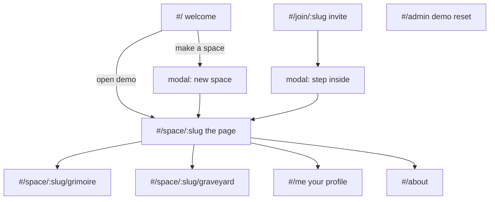

# Sitemap

Routing stays hash-based (`#/...`), handled in `src/App.tsx` + `src/lib/routes.ts`.

## Map


## Pages
| Route | Page | Upstream source | Status |
|---|---|---|---|
| `#/` | Welcome: pitch, "open the demo space", "make your own" | `pages/Welcome.tsx` | Reskin |
| `#/space/:slug` | The space page (profile header + board) | `pages/LiveSpace.tsx` | Reskin + new parts |
| `#/space/:slug/grimoire` | What this space knows (facts with sources, cross out) | `RoomKnows.tsx` (`/knows`) | Rename route, reskin. Redirect old `/knows` |
| `#/space/:slug/graveyard` | Dead pets and expired plans, with epitaphs | new `pages/Graveyard.tsx` | New |
| `#/join/:slug` | Invite landing, opens the step-inside modal over the blurred page | `JoinForm.tsx` | Reskin |
| `#/me` | Your name, look, away message, sound toggle, your spaces | `pages/Me.tsx` | Reskin + away message |
| `#/about` | What Afterspace is, how it's built, Built on (disclosure) | `pages/About.tsx` | Rewrite |
| `#/admin` | Demo reset (admin key) | `pages/Admin.tsx` | Keep |

Removed routes: `#/test`, `#/live`, `#/cursors`, `#/widgets`, `#/arrival`, `#/color`, `#/bothways`,
`#/outro`, `#/codex`, `#/firecrawl`, `#/wall`, `#/mail`, `#/play`.

## The space page, region by region
```
┌──────────────────────────────────────────────────────────────┐
│ profile header: banner · name · mood · Top 8 · visitors · ♪  │
├──────────────┬───────────────────────────────────────────────┤
│ space tabs   │  board (pannable): cards, pet floats, cursors │
│ (top strip   │                                               │
│ on phone)    │                                    [buddy list│
│              │                                     window]   │
├──────────────┴───────────────────────────────────────────────┤
│        crystal-ball ask bar  ·  + add card  ·  chat  ·  ⚙     │
└──────────────────────────────────────────────────────────────┘
```

## Modals and sheets (block the page)
| Name | Opened from | Contains | Source |
|---|---|---|---|
| Step inside (join) | `#/join/:slug`, first visit to a space | name, pick a look, "step inside" | `JoinForm.tsx` |
| New space | welcome, space tabs "+" | name, template, pet name, skin | `NewRoom.tsx`, `SpaceMaker.tsx` |
| Space settings | ⚙ in dock | name, mood line, skin, song, pet name, invite link, leave | `SettingsSheet.tsx`, `SpaceEditorPanel.tsx` |
| Card picker | "+ add card" | categories from cards.md | `WidgetPicker.tsx` |
| Card editor | card "edit" | fields per card | `WidgetEditorPanel.tsx` |
| Letter composer | "+ add card" > sealed letter, buddy list > "write" | to, text, photo, open-on date | new `LetterComposer.tsx` |
| Receipt capture | split card "scan a receipt", picker > split | camera/upload, preview, confirm split | new `ReceiptCapture.tsx` |
| Séance | auto on return after 24 h, dock menu | candle, up to 6 linked lines | new `SeanceSheet.tsx` |
| Revive ritual | pet when dead, graveyard | who's done their part (0-3 of 3) | new, inside `FamiliarPet.tsx` |
| Choice vote | AI write that touches others' choices | yes/no for the affected people | `ChoiceVote.tsx` |

## Panels and popovers (don't block)
| Name | Anchor | Contains | Source |
|---|---|---|---|
| Buddy list window | bottom-right, draggable, minimizable | online / away / offline, away message, write a letter | new `BuddyList.tsx` |
| Away message popover | your own row in the buddy list | text field, presets, "i'm back" | new |
| Pet popover | tap the pet | name, age, state, what would help | new `FamiliarPet.tsx` |
| Top 8 popover | tap a Top 8 face | why they're in your Top 8 ("3 polls together") | new |
| Card thread | card speech-bubble | thread | `WidgetThreadDock.tsx` |
| Chat | dock | space chat | `GlobalChatPanel.tsx` |
| Ask stage | crystal ball | live words, card skeletons landing | `VoiceStage.tsx`, `VoiceBuildLayer.tsx` |
| Hold halo + ghost | any held card | holder's name, parked AI change | `RightOfWay.tsx` |

## Toasts and transient UI
- Door creak + "wren stepped in" / "wren left".
- "waiting on theo" (AI change parked) / "dropped: the card changed" / "undo".
- "your letter was read".
- Pet state change ("wisp is getting hungry").
- Placement ghost while a card is being placed (`PlacementGhost.tsx`).

## Relationships
- Every card can open its thread; threads feed the grimoire's facts and the Top 8 graph.
- Activity on any card feeds the pet; the pet's death writes to the graveyard.
- Expired countdowns and closed polls older than 14 days move to the graveyard ("plans that died").
- Letters come from the composer, the buddy list, or the picker, and land as `letter` cards.
- Receipt capture writes into a `split` card (new or existing).
- The séance reads the room brief (grimoire facts) and recent activity, and links back to cards.
