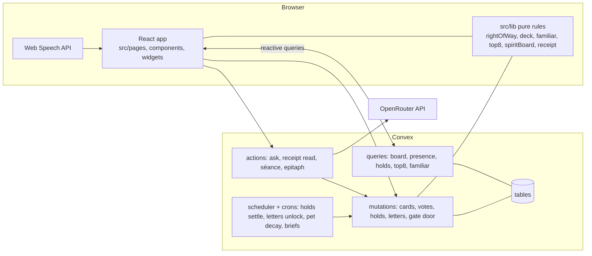

# Architecture after the fork

## What stays from upstream
- **Board sync:** one reactive query for the space and its cards (`spaces.getSpaceWithWidgets`), local
  snapshot for instant paint, mutations for create/move/resize/update/delete.
- **Presence and gestures:** custom `presence` table, 50 ms cursor sends, gesture lock for drags.
- **Right of Way:** pure gate in `src/lib/rightOfWay.ts`, server door in `convex/rightOfWay.ts`, holds in
  `leases`, parked writes in `pending`, AI write ledger in `aiWrites`.
- **The deck:** catalog + settings DSL + placement + streamed parse + pointer resolution in `src/lib/deck/`.
- **Room brief:** facts for the grimoire and pointer resolution (`convex/roomBrief.ts`).

## What changes
| Area | Upstream | Afterspace |
|---|---|---|
| Model provider | Nebius Token Factory (Nemotron) | OpenRouter via `convex/openrouter.ts` |
| Inbound content | AgentMail email, Firecrawl links, Tavily places | In-app letters and receipt photos only |
| Auth | Anonymous + email OTP + Google | Anonymous + optional Google |
| Recap | Daily/weekly digest + RAG | Séance from brief + activity, no embeddings |
| Components mounted | 18 | ~9 (see strip-plan.md) |

## New server modules
| File | Kind | Job |
|---|---|---|
| `convex/familiar.ts` | query, internal mutation, cron | Pet state; recompute every 30 min; death; revive |
| `convex/top8.ts` | query | Calls `src/lib/top8.ts` over the last 7 days of interactions |
| `convex/letters.ts` | mutation, scheduled | Send, open, unlock on date |
| `convex/receipts.ts` | action + mutation | Upload URL, vision read via OpenRouter, propose split, confirm |
| `convex/spiritBoard.ts` | mutation | Server-side lock from presence dwell |
| `convex/tables/after.ts` | tables | familiars, graveyard, letters, receipts, visits |

## Request flows
**Ask (voice/typed):** client `useVoiceBuild` → action `voiceBuild.deal` → `openrouter.streamChat` →
streamed lines parsed by `parseDeal` → client places with `placeCards` → mutation `voiceBuild.commit` →
`rightOfWay()` door → insert / park / refuse.

**Receipt:** client resizes image → `receipts.uploadUrl` → storage → action `receipts.read` (vision model,
JSON) → `src/lib/receipt.ts` validates → client confirm sheet → mutation `receipts.confirm` writes the split.

**Pet:** cron `familiar.tick` (30 min) → reads `activity` for 72 h → `src/lib/familiar.ts health()` → patch
state → on death insert graveyard row, schedule `familiar.epitaph` action.
